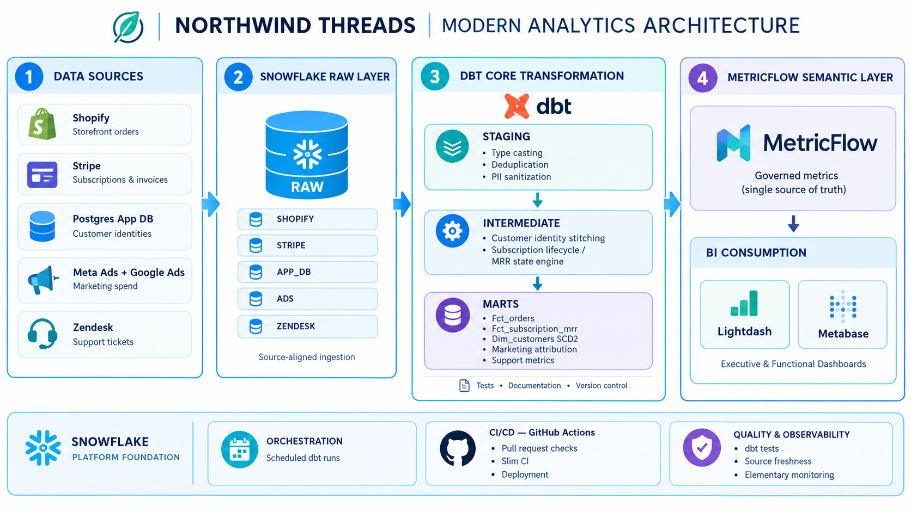
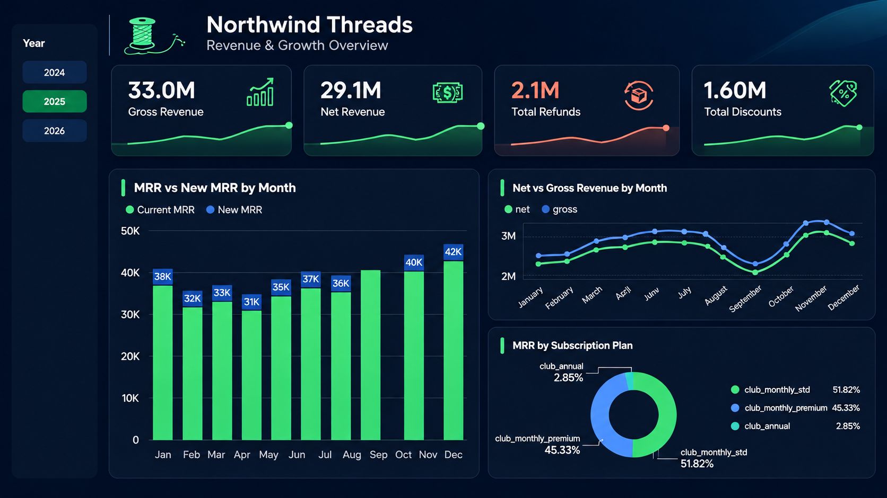
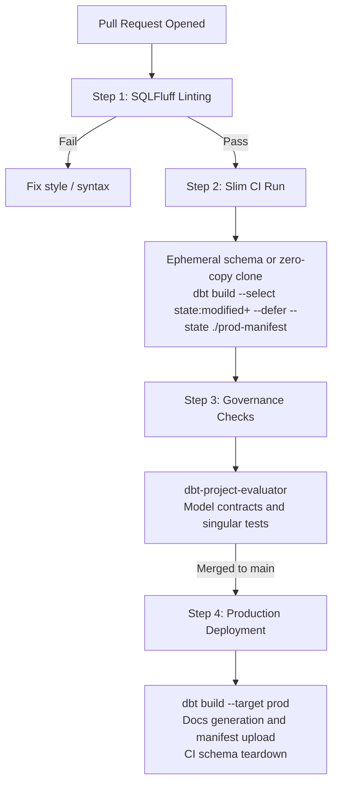

# 🧶 Northwind Threads: Modern Analytics Stack & Semantic Layer

> **A production-grade analytics platform that reconciles cross-functional revenue, multi-touch CAC/LTV attribution, and subscription MRR movements using Snowflake, dbt Core, MetricFlow, and GitHub Actions CI/CD.**

[](https://www.getdbt.com/)
[](https://www.snowflake.com/)
[](https://docs.getdbt.com/docs/build/about-metricflow)
[](https://github.com/features/actions)
[](#-data-quality--observability)

---

## 📑 Table of Contents

1. [Executive Summary](#-executive-summary)
2. [Pipeline Architecture](#-pipeline-architecture)
3. [Stakeholder Metrics Delivered](#-stakeholder-metrics-delivered)
4. [Warehouse Design](#-warehouse-design)
5. [Engineering Challenges & Data Traps](#-engineering-challenges--data-traps)
6. [Semantic Layer (MetricFlow)](#-semantic-layer-metricflow)
7. [BI Dashboard](#-bi-dashboard)
8. [CI/CD & Governance](#-cicd--production-governance)
9. [Data Quality & Observability](#-data-quality--observability)
10. [Repository Structure](#-repository-structure)
11. [Getting Started](#-getting-started)
12. [Business Impact](#-business-impact)
13. [Author](#-author)

---

## 🎯 Executive Summary

**Northwind Threads** is a high-growth direct-to-consumer (DTC) apparel brand running an e-commerce storefront and a recurring subscription club (*Threads Club*).

As headcount grew from 10 to 80, the business hit a data-maturity bottleneck:

| Problem | Impact |
| :--- | :--- |
| **Conflicting board reporting** | Finance, Marketing, and Operations presented three different revenue and customer numbers in board reviews. |
| **Isolated transaction systems** | Orders lived in **Shopify**, subscriptions and invoices in **Stripe**, customer identities in a **Postgres App DB**, and ad spend in **Meta / Google Ads**. |
| **Unmeasured unit economics** | The CMO could not reliably calculate blended vs. paid CAC or LTV:CAC by channel. Ops had no SKU-level refund visibility to stem margin loss. |

### The Solution

A centralized, tested, and contract-governed analytics warehouse on **Snowflake**, transformed with **dbt Core**, and exposed through a **MetricFlow Semantic Layer** so that every BI tool (Lightdash, Metabase) reads the same governed metric definitions.

---

## 🏗 Pipeline Architecture



| Stage | Layer | Description |
| :---: | :--- | :--- |
| **1** | **Data Sources** | Shopify (orders), Stripe (subscriptions and invoices), Postgres App DB (customer identities), Meta + Google Ads (spend), Zendesk (support tickets) |
| **2** | **Snowflake RAW** | Source-aligned ingestion into `RAW.SHOPIFY`, `RAW.STRIPE`, `RAW.APP_DB`, `RAW.ADS`, `RAW.ZENDESK` |
| **3** | **dbt Core** | **Staging** (type casting, deduplication, PII sanitization) → **Intermediate** (identity stitching, MRR state engine) → **Marts** (star schema) |
| **4** | **MetricFlow** | Governed metrics as a single source of truth, consumed by Lightdash and Metabase |
| ⚙️ | **Platform** | Scheduled dbt runs, GitHub Actions CI/CD, dbt tests, source freshness, and Elementary monitoring |

---

## 📊 Stakeholder Metrics Delivered

| Stakeholder | Business Question | Implemented Metrics | Core Mart / Semantic Entity |
| :--- | :--- | :--- | :--- |
| **CFO** | What is our true MRR, and where is growth coming from? | Subscription MRR · Expansion / Contraction MRR · Churned MRR · Net Revenue Retention (NRR) | `fct_subscription_mrr`, `semantic_subscriptions` |
| **CFO** | What is our net reconciled revenue after refunds and discounts? | Gross Revenue · Refunds · Discounts · Net Revenue | `fct_orders`, reconciliation singular test |
| **CMO** | Which paid channels deliver sustainable payback? | Channel CAC · Blended ROAS · 6-Month LTV:CAC | `fct_ad_spend`, `dim_channel_attribution` |
| **VP Ops** | Which SKUs drive support volume and margin loss? | Refund Rate by SKU · Tickets per 100 Orders | `fct_tickets`, `dim_products` |

---

## 🧱 Warehouse Design

### 1. Environment Isolation & Least-Privilege RBAC

Compute and access are separated to enforce least privilege and control credit consumption.

| Component | Configuration |
| :--- | :--- |
| **Warehouse** | `COMPUTE_WH` (X-Small, 60-second auto-suspend, resource monitors) |
| `LOADER` | Write-only access to ingest sources into `RAW.*` |
| `DBT_DEV` / `DBT_CI` | Isolated workspaces: `ANALYTICS_DEV`, `ANALYTICS_CI` |
| `DBT_PROD` | DDL/DML on production marts (`ANALYTICS.*`) |
| `BI_READER` | Read-only, restricted to `ANALYTICS.MARTS_*` |

### 2. Kimball Dimensional Model

| Model | Type | Description |
| :--- | :--- | :--- |
| `dim_customers` | Dimension (SCD2) | Unified customer master cross-referencing Shopify customer IDs, Stripe customer tokens, and App DB logins. Snapshot-enabled to trace lifecycle transitions. |
| `dim_products` | Dimension | Product and SKU attributes |
| `fct_orders` | Fact | Order line items joined with discount codes and order-level refund allocations |
| `fct_subscription_mrr` | Fact | Monthly subscription ledger classifying movements: *New, Retained, Expansion, Contraction, Churned, Reactivated* |
| `fct_ad_spend` | Fact | Normalized Google and Meta spend, the basis for CAC and ROAS |
| `fct_tickets` | Fact | Zendesk support tickets linked to orders and SKUs |

---

## 🪤 Engineering Challenges & Data Traps

Real-world raw data is messy. The pipeline explicitly handles and validates the following planted edge cases.

### 1. The "Two Revenues" Problem (Shopify vs. Stripe)

* **Trap:** Shopify records gross order value at checkout, while Stripe records settled cash net of processing delays and failed charges. A 3-day webhook sync failure in March 2025 created a known discrepancy window.
* **Fix:** An automated singular reconciliation test, `assert_shopify_stripe_revenue_matching.sql`, enforces a tolerance of **< 0.5%**. The tolerance absorbs settlement lag and replayed outage intervals.

### 2. Deduplication & Idempotent Ingestion

* **Trap:** Fivetran/Airbyte syncs produced duplicate rows for updated orders (`_fivetran_synced` mutations).
* **Fix:** Every staging model keeps only the latest version of each record:

```sql
  select *
  from {{ source('shopify', 'orders') }}
  qualify row_number() over (
      partition by id
      order by _fivetran_synced desc
  ) = 1
```

### 3. Channel Attribution & Dirty UTMs

* **Trap:** Inconsistent casing and naming (`Google`, `google`, `cpc`, `Paid-Search`) left spend unassigned.
* **Fix:** A centralized taxonomy seed (`seeds/channel_mapping.csv`) plus fallback attribution logic:

```text
  First-touch UTM → Last-touch UTM → HTTP referrer domain → "Direct / Organic"
```

### 4. Subscription State Machine (MRR Movement Classification)

* **Trap:** Naive monthly aggregation misses upgrades, downgrades, and reactivations, which produces incorrect churn.
* **Fix:** An event-based ledger in `int_subscription_mrr_movements.sql` uses `LAG()` to classify each delta:

  $$\Delta \text{MRR} = \text{MRR}_{t} - \text{MRR}_{t-1}$$

  | Condition | Classification |
  | :--- | :--- |
  | $\text{MRR}_{t-1} = 0$ and no prior history | **New** |
  | $\text{MRR}_{t-1} = 0$ and prior history exists | **Reactivation** |
  | $\Delta > 0$ | **Expansion** |
  | $\Delta < 0$ and $\text{MRR}_t > 0$ | **Contraction** |
  | $\text{MRR}_t = 0$ and $\text{MRR}_{t-1} > 0$ | **Churn** |
  | $\Delta = 0$ | **Retained** |

  Unit tests with deterministic fixtures verify the full lifecycle: `New → Retained → Expansion/Contraction → Churn → Reactivation`.

---

## 🧠 Semantic Layer (MetricFlow)

Metrics are declared once in YAML so that no dashboard or analyst re-implements revenue logic in raw SQL.

```yaml
# models/semantic/semantic_subscriptions.yml
semantic_models:
  - name: subscriptions
    model: ref('fct_subscription_mrr')
    defaults:
      agg_time_dimension: metric_date
    entities:
      - name: subscription
        type: primary
        expr: subscription_month_key
      - name: customer
        type: foreign
        expr: customer_id
    dimensions:
      - name: metric_date
        type: time
        type_params:
          time_granularity: month
      - name: plan_name
        type: categorical
    measures:
      - name: mrr_amount
        agg: sum
        expr: mrr
      - name: new_mrr_amount
        agg: sum
        expr: new_mrr
      - name: churned_mrr_amount
        agg: sum
        expr: churned_mrr

metrics:
  - name: monthly_recurring_revenue
    label: Monthly Recurring Revenue
    type: simple
    type_params:
      measure: mrr_amount

  - name: new_mrr
    label: New MRR
    type: simple
    type_params:
      measure: new_mrr_amount
```

**Verify with the MetricFlow CLI:**

```bash
mf query --metrics monthly_recurring_revenue,net_revenue_retention --group-by metric_time__month
```

---

## 📈 BI Dashboard

The final dashboard answers the stakeholder questions above directly from the semantic layer.



| Visual | Question Answered | Stakeholder |
| :--- | :--- | :--- |
| **KPI cards** (Gross Revenue, Net Revenue, Refunds, Discounts) | What is our net revenue after refunds and discounts? | CFO |
| **MRR vs New MRR by Month** | How is recurring revenue growing, and how much is new? | CFO |
| **Net vs Gross Revenue by Month** | What is the monthly revenue gap, and where is seasonality? | CFO / Finance |
| **MRR by Subscription Plan** | Which plans make up recurring revenue? (`club_monthly_std` 51.82%, `club_monthly_premium` 45.33%, `club_annual` 2.85%) | CFO / Product |

---

## 🚦 CI/CD & Production Governance

A GitHub Actions lifecycle keeps the warehouse scalable and catches defects before they reach production.



---

## ✅ Data Quality & Observability

| Control | Implementation |
| :--- | :--- |
| **Model contracts** | Enforced on all marts (`fct_*`, `dim_*`) to block schema drift |
| **Generic tests** | 120+ tests: `unique`, `not_null`, `accepted_values`, `relationships` |
| **Singular tests** | Cross-system reconciliation (Shopify vs. Stripe) |
| **Unit tests** | Deterministic fixtures for the MRR state machine |
| **Source freshness** | SLA-based freshness checks on all raw sources |
| **Elementary** | Daily monitors for volume anomalies and run durations |

---

## 📁 Repository Structure

```text
├── .github/
│   └── workflows/
│       ├── ci.yml                 # Slim CI with state deferral and ephemeral schemas
│       ├── cd.yml                 # Production deployment and docs upload
│       └── cleanup.yml            # Drops transient PR schemas
├── dbt_project.yml                # Project configuration and model paths
├── packages.yml                   # dbt_utils, dbt_expectations, dbt-project-evaluator
├── models/
│   ├── staging/                   # 1:1 with sources: casts, renames, light cleaning
│   │   ├── shopify/
│   │   ├── stripe/
│   │   ├── app_db/
│   │   ├── ads/
│   │   └── zendesk/
│   ├── intermediate/              # Identity stitching, attribution, MRR event ledger
│   ├── marts/                     # Star-schema consumption layer
│   │   ├── facts/                 # fct_orders, fct_subscription_mrr, fct_ad_spend, fct_tickets
│   │   └── dim/                   # dim_customers, dim_products, dim_channel_attribution
│   └── semantic/                  # MetricFlow semantic models and metrics
├── snapshots/                     # SCD Type 2 tracking for dim_customers
├── tests/
│   ├── singular/                  # Cross-system reconciliation tests
│   └── generic/                   # Reusable macro assertions
├── seeds/                         # channel_mapping.csv
└── images/                        # README assets
```

---

## 🚀 Getting Started

```bash
# 1. Clone and install
git clone https://github.com/<your-username>/northwind-threads-analytics.git
cd northwind-threads-analytics
python -m venv .venv && source .venv/bin/activate
pip install dbt-snowflake metricflow

# 2. Configure your Snowflake profile (~/.dbt/profiles.yml), then:
dbt deps
dbt seed
dbt build

# 3. Query governed metrics
mf query --metrics monthly_recurring_revenue --group-by metric_time__month
```

---

## 💼 Business Impact

| Outcome | Result |
| :--- | :--- |
| **Eliminated board misalignment** | Net Revenue and Active Subscribers reconcile across Finance and Marketing within the 0.5% tolerance. |
| **Capital efficiency** | Revealed a **2.1×** gap in LTV:CAC between Meta lookalike audiences and Google search campaigns. |
| **Proactive defect detection** | Ops can flag high-refund SKUs within 7 days of a drop, preventing over-purchasing. |
| **Developer velocity** | CI runtime reduced by **68%** using Slim CI (`state:modified+`) and ephemeral schema teardown. |

---

## 👤 Author

**[David Asikpo]** · Analytics Engineer
